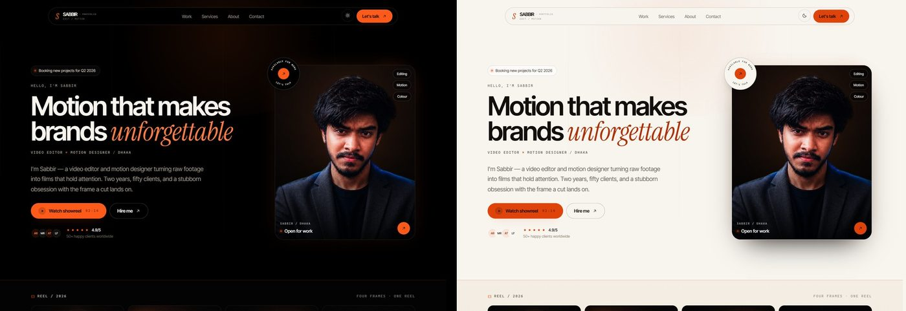

# SABBIR — Video Editor × Motion Designer

A fast, editorial portfolio with a real admin panel. Ember-orange palette, dark + light themes,
hand-built motion, no animation libraries.



---

## Quick start

```bash
npm install
cp .env.example .env.local     # Windows: copy .env.example .env.local
npm run dev                    # http://localhost:3007
```

Production:

```bash
npm run build
npm start
```

**Admin:** <http://localhost:3007/admin> — default password `sabbir2026` (from `.env.local`).
Change `ADMIN_PASSWORD` and `AUTH_SECRET` before deploying.

---

## What's inside

| Area | Details |
| --- | --- |
| Public pages | `/` homepage, `/work` archive, `/work/[slug]` case study |
| Admin | `/admin` overview, projects CRUD, services & process, testimonials, message inbox, media library, site settings |
| Content | `data/content.json` — plain, readable JSON, no database |
| Uploads | `public/uploads/` (created automatically) |
| Themes | Dark by default, light fully designed, choice persisted in `localStorage` |
| Accent | 4 orange presets, switchable in **Admin → Settings** |

### Home sections

Portrait-led hero (availability pill, statement headline, rotating availability badge, floating
skill pills, rating row) → unified reel band (four stills + capability ticker) → selected work
(bento grid with hover-preview clips) → services accordion → process → stats → trusted-by table →
testimonials → circular about → split contact panel → oversized footer wordmark.

### Design language

- **Palette** — ember `#FF5A1A` on true AMOLED black `#000000` (cards sit at `#0A0A0A`);
  light mode is warm paper `#F7F5EF`.
- **Type** — Inter Tight for display/UI, Instrument Serif italic for accent words, monospace
  micro-labels for technical texture.
- **Shapes** — 22–30px radii, floating pill tags, circular badges, one dark ember-edged reel band.
- **Motion** — pure CSS transitions/keyframes driven by one IntersectionObserver: page reveals,
  intro curtain, hover-preview videos, accordion grid-row transitions, marquee drift.
- **Performance** — flat surfaces, no backdrop blurs, no fixed/attached backgrounds, no full-screen
  blend layers. Scroll measured at 60 fps (p95 frame 16.8 ms) even with 4× CPU throttling.
- **Portrait** — the subject is cut out and placed on a warm studio backdrop; skin, hair and
  wardrobe stay natural, and the theme comes from the frame, the ember halo and the UI around it
  (`scripts/cutout_portrait.py`). Two crops ship: 4:5 for the hero, square for the circular about.
- **Mobile** — the hero reflows to message → actions → portrait, section headers go left-aligned,
  the nav collapses to a compact frosted pill, filters scroll horizontally and the footer becomes
  a two-column link grid.

---

## Editing content

### Through the admin (recommended)
1. Go to `/admin`, sign in.
2. **Projects** — create, edit, reorder (↑ ↓), delete. Each project has poster, film URL
   (mp4 or YouTube/Vimeo), optional hover-preview loop, gallery stills, results and card size.
3. **Services / Testimonials** — inline editors with one Save per collection. Each service also
   takes a card image shown when its accordion row is open.
4. **Messages** — the contact-form inbox; reply, mark read, delete.
5. **Media** — drag-and-drop upload, click any path to copy it.
6. **Settings** — name, wordmark, role, tagline, bio, portraits (4:5 + square), socials, stats,
   SEO, accent colour, availability and showreel.

Saving writes to `data/content.json` and immediately revalidates the public pages.

### By hand
Everything is in `data/content.json`. Edit it, save, refresh. Schema lives in `lib/types.ts`.

---

## Customising the design

### 1. Brand colours
`app/globals.css` → the `:root` / `[data-theme="light"]` blocks:

```css
--bg: #0b0a09;        /* page background      */
--elev: #12100e;      /* raised surfaces      */
--ink: #f6f2ea;       /* primary text         */
--muted: #a49b8f;     /* secondary text       */
--accent: #ff5a1a;    /* ember — the only saturated colour */
--accent-ink: #0b0806;/* text on accent buttons */
```

Change these five and the whole site follows. Accent presets live just below.

### 2. Type
Fonts are self-hosted in `public/fonts/` (`Inter Tight` + `Instrument Serif`).
Swap the `@font-face` files and update `--font-sans` / `--font-serif` in the `@theme` block.

### Deploy (Vercel)

- **Repo** — [github.com/sabbirexist/personal-web](https://github.com/sabbirexist/personal-web)
- **Live** — [visualsbysabbir.vercel.app](https://visualsbysabbir.vercel.app)
- **Analytics** — Vercel Web Analytics via `@vercel/analytics` (`<Analytics />` in the root layout).
- **Env vars** — `ADMIN_PASSWORD`, `AUTH_SECRET`, `NEXT_PUBLIC_SITE_URL` (see `.env.example`).
- **Storage** — on Vercel the admin panel writes to **Vercel Blob** (`data/content.json` and uploaded
  files), so messages, edits and uploads persist on the live site. Locally it still uses the JSON file.
  `BLOB_READ_WRITE_TOKEN` is injected by the Blob store connection (`sabbir-content`).

### 3. Logo
`components/logo.tsx` — one signature-serif SVG path (`LogoMark`) drives the nav mark, footer mark,
preloader, favicon source and OG image. Edit the path once. `public/favicon.svg` is the
standalone copy used by browsers.

### 4. Portrait
Replace the two files in `public/work/` (`sabbir-portrait.webp`, `sabbir-square.webp`) or upload
new ones in **Admin → Settings → About**. To repeat the treatment on a new photo (cut out the
subject, natural colour, ember studio backdrop):

```bash
python scripts/cutout_portrait.py     # needs rembg + onnxruntime
```

### 5. Section order
`app/(site)/page.tsx` is a plain list of section components — reorder or remove freely.

### 6. Motion
All motion is CSS: reveal-on-scroll (`[data-reveal]`), the `.lines` text mask, marquees,
hover states and the intro curtain. `components/client/motion.tsx` holds the single
IntersectionObserver, the scroll-progress bar and the hero spotlight.
`prefers-reduced-motion` disables everything.

---

## How it's built

- **Next.js 16** App Router, pre-rendered public pages (ISR, 1 h) + server routes for the CMS.
- **Tailwind CSS v4** with a semantic token layer (`--bg`, `--ink`, `--accent`…).
- **No animation library, no icon library, no state library.** ~1 KB of custom client JS besides React.
- Self-hosted fonts (≈136 KB for four faces, latin subset, `font-display: swap`).
- Motion assets are procedural (`scripts/gen_video.py`, ffmpeg): the showreel is 1 MB,
  the three hover loops are 13–30 KB each and only load on hover (`preload="none"`).
- Images are WebP with fixed aspect ratios and `loading="lazy"` — zero CLS.

### Project structure

```
app/
  (site)/            public pages (home, work, case study) + shared nav/footer
  admin/             login + protected panel routes
  api/               auth, contact, admin CRUD, upload, media
components/
  site/              section components (hero, services accordion, sections, about…)
  admin/             CMS UI
  client/            tiny interactive islands
  icons.tsx          hand-drawn 40-icon stroke set
  logo.tsx           monogram + wordmark
lib/                 types, JSON store, auth, helpers
data/content.json    all content
public/              fonts, portraits, posters, motion loops, uploads
scripts/             asset generation + automated screenshots
docs/PLAN.md         research, decisions and build notes
```

---

## Security notes

- Admin auth = HMAC-signed HttpOnly cookie (7 days), password compared in constant time,
  8 attempts per 10 min per IP.
- API routes verify the session independently of page routing.
- Uploads are extension-whitelisted and size-capped at 30 MB; only files under
  `public/uploads/` can be deleted.
- Change `ADMIN_PASSWORD` + `AUTH_SECRET` and serve over HTTPS. For a multi-user CMS,
  put Cloudflare Access or a basic-auth reverse proxy in front of `/admin`.

## Deployment

Works on any Node host with a writable disk (VPS, Docker, Railway, Render, Coolify).
`data/` and `public/uploads/` must persist — mount them as volumes. On read-only hosts
(e.g. Vercel's default filesystem) the public site works, but admin writes will fail;
attach a database or object storage if you need that.

## Scripts

```bash
npm run dev        # dev server on :3007
npm run build      # production build
npm start          # production server
npm run typecheck  # tsc --noEmit
```

Asset generation (optional, needs Python 3, numpy, Pillow and ffmpeg):

```bash
python scripts/gen_art.py        # poster art
python scripts/gen_video.py      # showreel + hover loops
python scripts/grade_portrait.py # ember-grade a portrait
node scripts/og2.mjs             # Open Graph card + apple icon
```

---

Designed and built as a starting point for your work — replace the placeholder posters and
case studies with your real films and it becomes yours.
